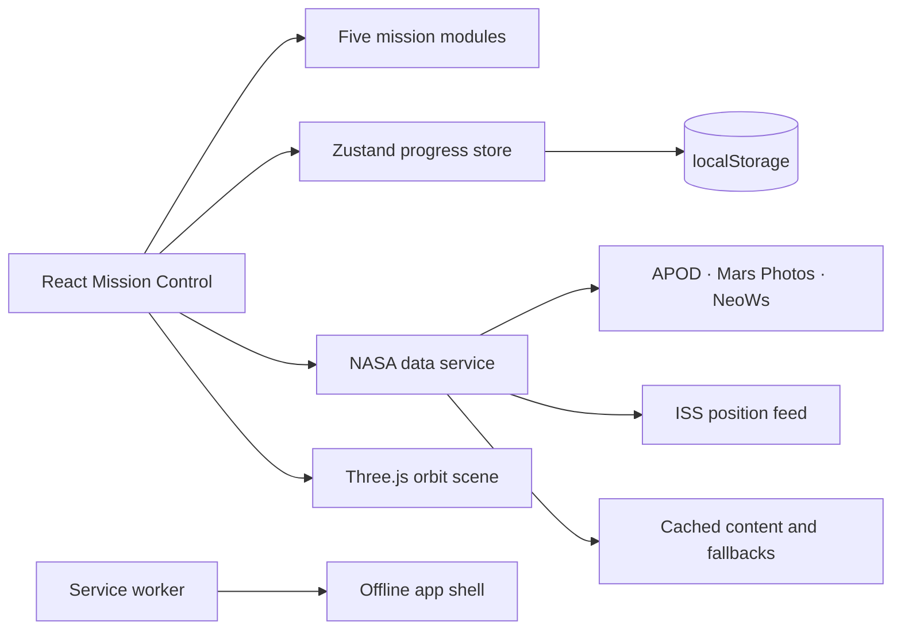

demo : https://rahathfarheen.github.io/junior-astronaut-mission-trainer/

<div align="center">

# 🚀 Junior Astronaut Mission Trainer

**Real space science. Big adventures. Your first steps toward the stars.**

An open-source astronaut training experience for explorers ages 8–14.

[](https://github.com/OWNER/junior-astronaut-mission-trainer/actions/workflows/ci.yml) [](LICENSE) [](https://www.typescriptlang.org/)

**Live demo:** `https://<your-github-username>.github.io/junior-astronaut-mission-trainer/` (available after the first push to `main` and Pages deployment) · **[Report a bug](../../issues/new?template=bug_report.yml)** · **[Request a mission](../../issues/new?template=feature_request.yml)**


*🎬 Demo GIF placeholder — add a short screen recording here: `docs/images/demo.gif`*

</div>

## Why this project?

Space makes STEM tangible. A checklist becomes systems thinking, orbital motion becomes physics you can see, and a rover route becomes computational thinking. Junior Astronaut Mission Trainer turns those ideas into short, playful challenges so students can build curiosity and confidence through exploration. It is designed for ages 8–14 and works without an account or backend.

## ✨ Mission highlights

- **Mission Control hub** — rank up from Cadet to Pilot to Commander, earn XP and badges, and track progress locally.
- **Five hands-on missions** — Launch Sequence checklist and countdown; Orbit Mechanics speed/altitude simulation; Spacewalk microgravity controls; Mars Rover route puzzle with NASA imagery; adaptive Mission Control quiz with explanations.
- **A living sky** — NASA Astronomy Picture of the Day, Mars rover photos, Near-Earth Object counts, and a live ISS position feed. Cached data and friendly fallbacks keep the app resilient.
- **Your name among the stars** — generate a downloadable Junior Astronaut Certificate.
- **Works on your device** — localStorage progress and an installable PWA shell for offline core missions.
- **Designed for everyone** — keyboard controls, clear focus, screen-reader labels, reduced motion, high contrast, responsive layout, and English/Hindi/Kannada translation foundations.
- **No NASA endorsement implied** — NASA open data is credited; NASA logos and insignia are not used.

## 🧰 Built with

React 19 · Vite · TypeScript (strict) · Tailwind CSS · Framer Motion · Three.js · Zustand · Vitest · GitHub Actions

## 🧭 Architecture



See [architecture and design decisions](docs/architecture.md).

## 🌌 NASA APIs and attribution

This project uses NASA open data for educational purposes. NASA does not sponsor, endorse, or maintain this project. NASA insignia and logos are not included.

- **Astronomy Picture of the Day (APOD):** [api.nasa.gov/planetary/apod](https://api.nasa.gov/planetary/apod) — image, title, and description are credited to NASA/APOD on the app.
- **Mars Rover Photos:** [api.nasa.gov/mars-photos](https://api.nasa.gov/mars-photos/) — rover images and metadata are served by NASA. Individual mission teams and image credits remain with NASA/JPL-Caltech and the relevant instrument teams.
- **Near Earth Object Web Service (NeoWs):** [api.nasa.gov/neo](https://api.nasa.gov/neo/) — daily count is used for educational context.
- **International Space Station position:** [Where the ISS at API](https://wheretheiss.at/w/developer) — free coordinate feed; this is a community API, not a NASA endpoint.

The app uses NASA's public `DEMO_KEY` by default. It has strict shared rate limits. Responses are cached on the device and local fallback values keep the experience available if a feed is unavailable. For a public high-traffic deployment, route requests through a small server-side proxy with your own NASA API key; never put a private key in browser code.

### Dataset used

The Mars Rover Photos API is the real NASA image dataset used in the rover mission. It provides Curiosity rover photographs and capture metadata. **Dataset/API link:** [NASA Mars Rover Photos API](https://api.nasa.gov/mars-photos/). The app requests a Curiosity photo at sol 1000; image availability depends on NASA's current API response.

## 🚀 Run locally

Requirements: Node.js 22+ and npm.

```bash
npm install
npm run dev
npm run lint && npm test && npm run build
```

Open the local URL printed by Vite. No API key is needed for the demo. Optional production API configuration is described in [docs/architecture.md](docs/architecture.md).

## 📦 Project structure

```text
src/
  components/     Mission modal, certificate, Earth scene
  data/           Mission catalog and progression rules
  i18n/           English, Hindi, and Kannada starter strings
  services/       NASA and ISS data with caching/fallbacks
  store/          Persisted player state
  test/           Test setup
  App.tsx         Mission Control composition
  styles.css      Responsive visual system and accessibility modes
public/           PWA manifest, service worker, icon
docs/             Architecture and design decisions
.github/          CI/deploy workflow and contribution templates
```

## 🗺️ Roadmap

- [x] Mission hub, five playable modules, XP/ranks/badges
- [x] NASA live feeds, local caching, and fallback content
- [x] Downloadable certificate and local progress
- [x] PWA shell, accessibility settings, translation starter
- [x] CI, tests, project governance docs
- [ ] Expand full mission translations and add language picker
- [ ] Add teacher lesson plans and classroom group mode
- [ ] Add a richer orbital model and more rover terrain levels
- [ ] Add API proxy deployment option for high-volume public hosting

## 👩‍🚀 Team

Built for NASA hackathon judges and the next generation of explorers. Contributions from educators, students, designers, and developers are welcome.

## 🙏 Acknowledgments

NASA Open APIs, NASA/JPL-Caltech rover teams, the open source React/Vite/Three.js communities, and every young person who asks “what if?”

## 📄 License

MIT. See [LICENSE](LICENSE).
