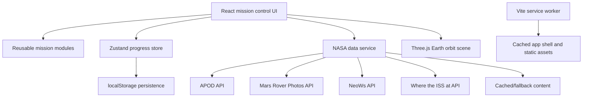

# Architecture and design decisions

## Design decisions

- The app is static and backend-free. Zustand persists player progress on the device so minors do not need accounts.
- NASA endpoints use `DEMO_KEY` by default. NASA's public demo key is rate limited; the data service catches failures and serves local demo content or the last cached response. Set a private API key via a deployment proxy before broad public traffic; do not commit secrets.
- Rover imagery uses NASA Mars Rover Photos API imagery. The puzzle remains playable if the API has no image or is offline.
- ISS position uses the free Where the ISS at API because NASA Open APIs do not currently provide a simple unauthenticated live coordinate endpoint. It is labeled clearly.
- Mission models teach conceptual physics. Orbit speeds/altitudes are illustrative and avoid claiming a precise orbital propagator. All live numerical feeds are presented as educational context.
- The visual scene is a procedural Three.js model, not a scientific rendering or NASA asset. No NASA logo, insignia, or endorsement is implied.
- Accessibility is built into semantic buttons, keyboard controls, focus indicators, a skip link, contrast/reduced-motion switches, and status announcements. Translation foundations include English, Hindi, and Kannada; content translation can grow incrementally.
- The service worker caches the app shell and same-origin build resources. API results use localStorage caching so missions and the last available content survive offline use.
